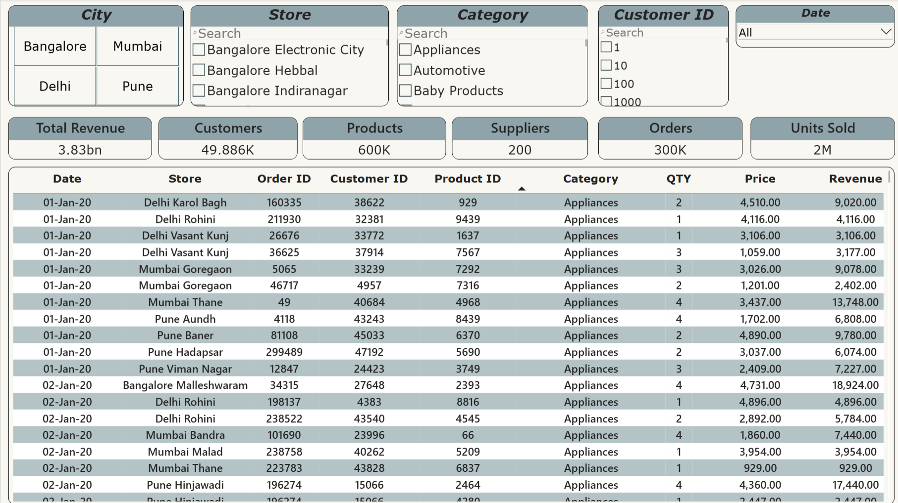

# Retail Supply Chain 

An end-to-end retail analytics project built with **Python, PostgreSQL,
SQL, and Power BI**. It explores sales, products, stores, customers,
suppliers, promotions, shipments, and returns through a relational data
model and a seven page interactive dashboard.

* The dataset has been obtained from kaggle datasets and is synthetic and intended for data analytics practice and
demonstration.

* The currency is unspecified.

* KPI results depend on the DAX definitions, relationship
configuration, and report filters.

## Dashboard Preview

### 1. Executive Overview

High-level KPIs and order-level details, with filters for city, category, store, customer, and date.

### 2. Sales & Revenue

Revenue trends and comparisons across categories, stores, and products.

### 3. Product Analysis

Product, brand, and category performance, including top-performing items.

### 4. Store Performance

Store rankings by revenue and order volume, regional revenue, and store-related KPIs.

### 5. Customer Analysis

Customer revenue, order activity, city-level customer summaries, and recent customer orders.

### 6. Supplier Analysis

Supplier rankings, supplier-related metrics, and shipment-status distribution.

### 7. Returns & Promotions

Returns, refunds, promotion information, return-rate metrics, and category-level return patterns.

---

Tools Used 

Python                              Data generation, enrichment, and
validation scripts

PostgreSQL                          Relational data storage and SQL
querying

pgAdmin                             PostgreSQL database administration

Power BI Desktop                    Data modeling, DAX measures, and
dashboard development

Visual Studio Code                  Python development and project
organization

### Data coverage

* **Order date range:** 1 January 2020 -- 1 January 2024
* **Customer/store cities:** Bangalore, Delhi, Mumbai, and Pune
* **Supplier countries represented:** India, China, and the USA
* **Database:** PostgreSQL

Row counts are approximate and may change if the data is regenerated or
edited.

## Dashboard Pages and Business Questions

### Overview

* What are the overall revenue, order, customer, product, supplier,
and unit metrics?
* How do order-level details change under the selected filters?

### Sales \& Revenue

* How does revenue change over time?
* Which categories, stores, and products contribute the most revenue?

### Product Analysis

* Which products and brands rank highest by revenue?
* Which product categories perform strongly?

### Store Performance

* Which stores rank highest by revenue and order volume?
* How does revenue vary by city or reporting region?
* How many stores and employees are represented?

### Customer Analysis

* Which customers generate the most revenue?
* Which customers place the most orders?
* How do customer counts and order activity vary by city?
* What do recent customer orders look like?

### Supplier Analysis

* Which suppliers rank highest by revenue?
* How are shipment statuses distributed?
* How do supplier-related metrics vary across cities and selected
filters?

### Returns \& Promotions

* How are return records and refunds distributed?
* Which categories have the most return records?
* How do promotion attributes relate to orders and returns?

## Data Model

The model links the core business entities:

* `customers` → `orders`
* `stores` → `orders`
* `orders` → `order\_items`
* `products` → `order\_items`
* `categories` → `products`
* `suppliers` → `products`
* `promotions` → `orders`
* `orders` → `payments`
* `orders` → `shipments`
* `order\_items` → `returns`

The Power BI report also uses a date table for date-based filtering and
time analysis. Relationship activity, cardinality, and filter direction
should be checked when adapting the model to another environment.

## Python Scripts

The project includes scripts used during data preparation and
enrichment, including scripts for generating product names, assigning
region information, and fixing store names. Review each script's input
paths, output paths, and dependencies before running it on another
machine.

